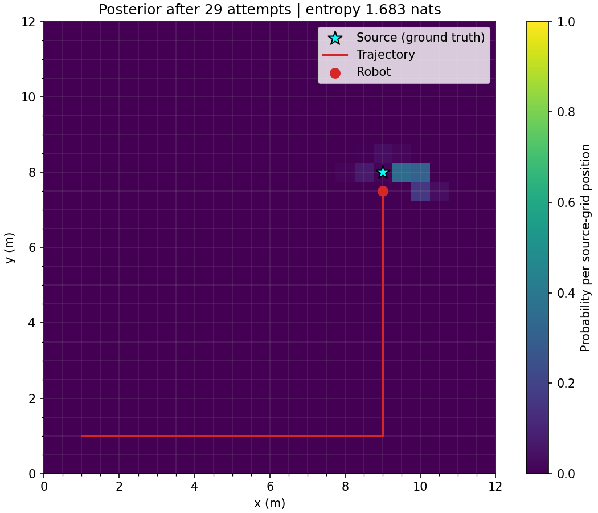

# Belief-Space Planning for Autonomous Radio-Source Localisation

A working simulation research project investigating radio-source search under
noisy measurements. It combines Bayesian source-location beliefs, greedy
pursuit, information-seeking policies and experimental dual-control variants.

This release preserves the existing implementation. It is a baseline for
continued research, not a completed claim of general controller superiority.
See [PROVENANCE.md](PROVENANCE.md) for researcher and Codex contributions.

## Run a self-contained example

From the repository root, using Python 3.10+:

```powershell
python -m venv .venv
.\.venv\Scripts\python.exe -m pip install -e .
.\.venv\Scripts\python.exe examples/plot_example.py --seed 17
.\.venv\Scripts\python.exe examples/run_greedy.py
.\.venv\Scripts\python.exe -m unittest discover -s tests -v
```

With an existing compatible environment, the same commands can use `python`.
The plotting example writes `outputs/example.png` without opening a window;
`--animate` additionally saves a GIF. The greedy runner writes a seeded episode
record to `outputs/greedy-seed-17.json`. These examples need no external dataset.

## Model and controller scope

The analytic model uses a 12 m × 12 m field, a 0.5 m grid, known robot position,
one stationary hidden source and Gaussian-noisy log-distance RSSI. The grid
has 625 candidate positions. Source truth belongs to simulation/evaluation,
not the controller's observation interface. [Model details](docs/MODEL.md).

| Component | Release status |
|---|---|
| Bayesian prior, likelihood, posterior and entropy | Implemented; numerical/integration tests included |
| Greedy MAP pursuit and confirmation | Implemented; seeded example and tests included |
| Monte Carlo information seeking | Implemented; isolated decision example and tests included |
| Radio-map environments, BFS routing and oracle | Existing experimental modules; dataset not bundled |
| Two-stage Euclidean/BFS-distance DCEE variants | Existing experimental implementations and fixture tests; no general performance claim |
| Broader research interpretation and comparative evaluation | Ongoing; no new benchmark conclusions added in this release |

## Actual example



The pictured path is prescribed in advance. It demonstrates sensing and Bayesian
estimation, not a controller comparison. Ground truth is displayed for evaluation
only. See [VALIDATION.md](VALIDATION.md) for the commands and observed checks.

## Optional radio-map work

Some experimental modules use the separately obtained original RadioMapSeer
dataset. It is not required for the analytic examples or fixture-based tests.
Data-dependent tests explicitly skip when the subset is absent; skipped tests
are not claimed as passing checks of the real dataset.

The [GitHub Actions workflow](.github/workflows/tests.yml) installs the package
on Linux with Python 3.12 and runs the full test discovery without downloading
optional data. Local verification on 3 November 2026 discovered **106 tests:
101 passed, 5 skipped, 0 failures/errors**. CI prints each skip reason and writes
actual pass/skip counts and skipped test names to its job summary. The five
optional-data skips cover four published-data integrity checks and one
real-map environment check; fixture-based radio-controller tests still run.
Actions reports the separate CI outcome. This is not a RadioMapSeer benchmark.

See [DATA.md](DATA.md) for the source, expected layout and conventions. No
third-party radio maps, full historical benchmark output, model weights or
downloaded research papers are included. This release does not claim that
RadioMapSeer benchmarks have been rerun or packaged for one-command reproduction.

## Limitations

The analytic noise and propagation model are simulation assumptions, not field
calibration. Greedy declaration can be wrong; information-gain estimates have
Monte Carlo variation. Reaching the true source and estimating its location are
different metrics, and runner stopping modes differ. Radio-map and analytic
models must not be compared as though their assumptions were identical.

Test coverage does not establish real-world validity, statistical superiority,
equal computational budgets or completion of dual-control research. Existing
research code and scientific behaviour have not been changed for presentation.

## Licence

Code is released under [MIT](LICENSE). Third-party datasets retain their own
terms; see [DATA.md](DATA.md). Source-file hashes for this extraction are in
[docs/SOURCE_MANIFEST.json](docs/SOURCE_MANIFEST.json).
